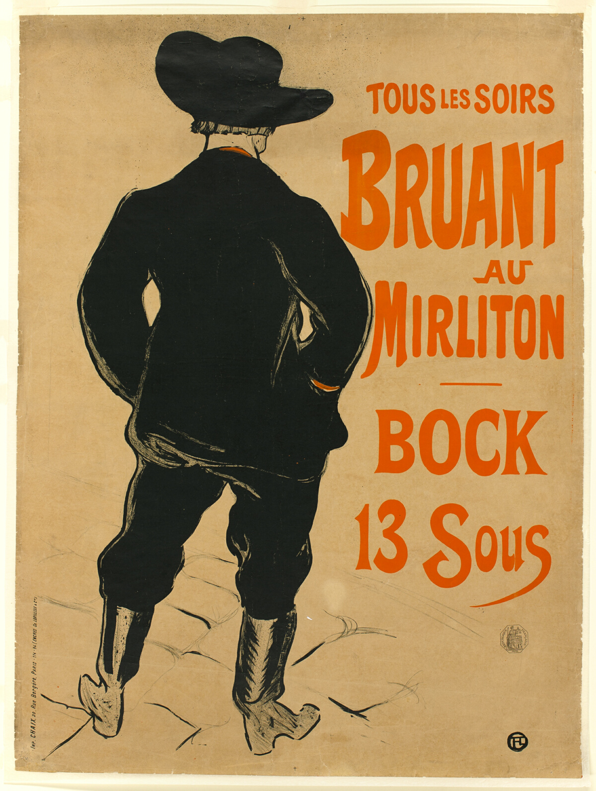

# Aristide Bruant

自动生成；以 case.json 为准。

## 元数据

- 编号：P-0066
- 作者：Henri de Toulouse-Lautrec
- 年份：1893
- 原用途：performance
- 状态：已复核

## 标签

- 视觉路线：有机插画
- 艺术史：未确定
- 构图：分割对照

- 视觉主体：图像主导
- 文字密度：低文字密度
- 气质：克制
- 表现手法：平面色块
- 文字处理：定制展示字形
- 色彩：limited_palette / strong / black, red, brown

### 可迁移概念及依据

- 身份：帽子和背影替代面部肖像

### 艺术史关系及依据

## 分析

**视觉机制：** 左侧黑衣背影占据大面积，右侧红色字列独立排列。此处描述以所见图像为依据。

**可迁移方法：** 可迁移的编排策略：左侧黑衣背影占据大面积，右侧红色字列独立排列；改用于书籍宣传时，以书的核心物象替换主图，沿原有文字区安排书名和一条核心信息。

**失败风险：** 这一结构依赖帽子和背影替代面部肖像；若把书名、作者和多条卖点都放到主图轮廓内部，会削弱该关系。

**标注依据：** Collected and initially annotated separately; root inspected the complete local image, compared the primary-source identity and corrected visible classification conflicts.

## 来源

- [作品记录](https://www.artic.edu/artworks/13598)
- [图片来源](https://www.artic.edu/iiif/2/31d7fb60-ddd1-c78d-1cc1-eca25cb603c1/full/1200,/0/default.jpg)
- 来源证据：Source record and local image identity were reviewed; see source_url and review.
- 权利：CC0-1.0; see CREDITS.md and rights/release-manifest.json. Release decision covers these exact image bytes under the museum designation. See the shared policy evidence for scope and third-party limits.
- 备注：Release starter reference. Rights review is separate from visual/source review.
