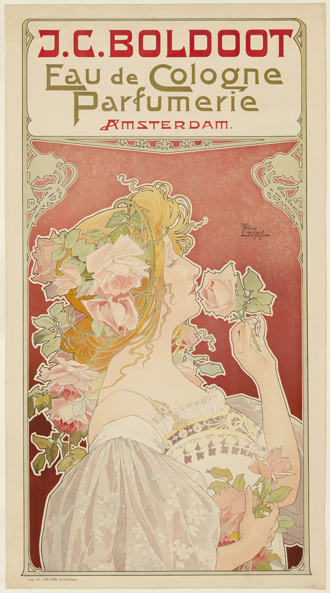

# J.C. Boldoot Eau de Cologne: Parfumerie Amsterdam

自动生成；以 case.json 为准。

## 元数据

- 编号：P-0070
- 作者：Privat-Livemont
- 年份：c. 1899
- 原用途：commercial
- 状态：已复核

## 标签

- 视觉路线：装饰纹样
- 艺术史：新艺术运动（视觉近似）
- 构图：框景包围

- 视觉主体：图像主导
- 文字密度：低文字密度
- 气质：亲近
- 表现手法：线描, 有机曲线
- 文字处理：定制展示字形
- 色彩：limited_palette / strong / pink, green, yellow

### 可迁移概念及依据

- 生长：花茎与衣裙曲线向上生长

### 艺术史关系及依据

- 新艺术运动（视觉近似）：花茎与衣裙、发丝连成细长有机曲线，品牌框保留装饰边缘。

## 分析

**视觉机制：** 顶部品牌在独立浅色框中，女子和花茎构成下方连续曲线。此处描述以所见图像为依据。

**可迁移方法：** 可迁移的编排策略：顶部品牌在独立浅色框中，女子和花茎构成下方连续曲线；改用于书籍宣传时，以书的核心物象替换主图，沿原有文字区安排书名和一条核心信息。

**失败风险：** 这一结构依赖花茎与衣裙曲线向上生长；若把书名、作者和多条卖点都放到主图轮廓内部，会削弱该关系。

**标注依据：** Collected and initially annotated separately; root inspected the complete local image, compared the primary-source identity and corrected visible classification conflicts.

## 来源

- [作品记录](https://www.artic.edu/artworks/16876)
- [图片来源](https://www.artic.edu/iiif/2/ea81dbe1-8f50-896e-81f6-253fe24cf5f7/full/1200,/0/default.jpg)
- 来源证据：Source record and local image identity were reviewed; see source_url and review.
- 权利：CC0-1.0; see CREDITS.md and rights/release-manifest.json. Release decision covers these exact image bytes under the museum designation. See the shared policy evidence for scope and third-party limits.
- 备注：Release starter reference. Rights review is separate from visual/source review.
