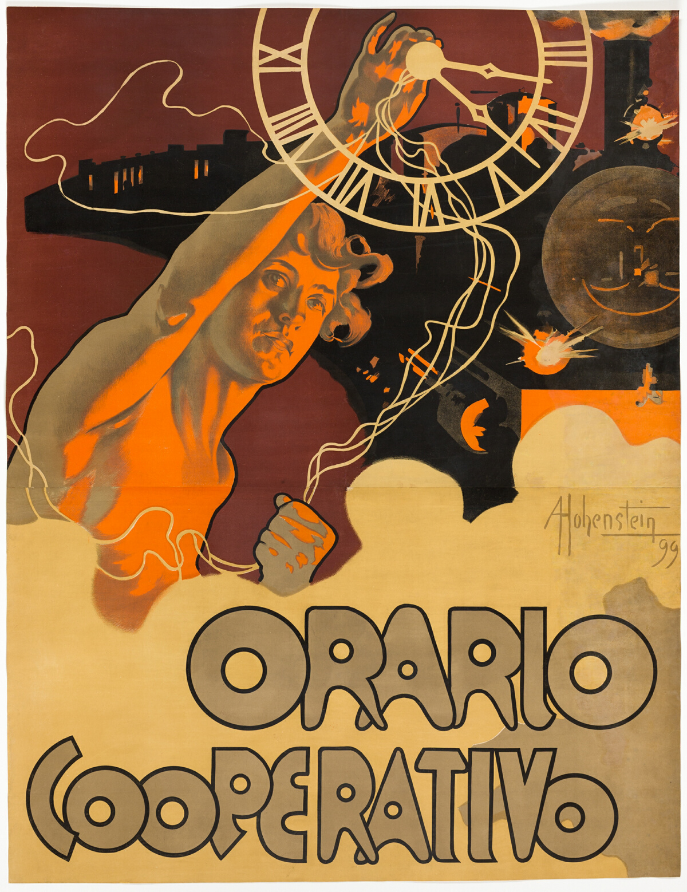

# Time Cooperative

自动生成；以 case.json 为准。

## 元数据

- 编号：P-0071
- 作者：Adolf Hohenstein
- 年份：1899
- 原用途：performance
- 状态：已复核

## 标签

- 视觉路线：有机插画
- 艺术史：新艺术运动（视觉近似）
- 构图：层叠堆积

- 视觉主体：图像主导
- 文字密度：中文字密度
- 气质：戏剧性
- 表现手法：线描, 有机曲线
- 文字处理：定制展示字形
- 色彩：limited_palette / strong / orange, yellow, black

### 可迁移概念及依据

- 时间：钟面将抽象时间变成主要视觉物

### 艺术史关系及依据

- 新艺术运动（视觉近似）：伸展身体、盘绕曲线与圆胖装饰字形在平面中互相缠绕。

## 分析

**视觉机制：** 时钟占上角，伸出的手臂穿过画面，圆胖标题稳住底部。此处描述以所见图像为依据。

**可迁移方法：** 可迁移的编排策略：时钟占上角，伸出的手臂穿过画面，圆胖标题稳住底部；改用于书籍宣传时，以书的核心物象替换主图，沿原有文字区安排书名和一条核心信息。

**失败风险：** 这一结构依赖钟面将抽象时间变成主要视觉物；若把书名、作者和多条卖点都放到主图轮廓内部，会削弱该关系。

**标注依据：** Collected and initially annotated separately; root inspected the complete local image, compared the primary-source identity and corrected visible classification conflicts.

## 来源

- [作品记录](https://www.artic.edu/artworks/17079)
- [图片来源](https://www.artic.edu/iiif/2/6127bf0f-24ca-fb9a-8be9-84fd3d8dc7de/full/1200,/0/default.jpg)
- 来源证据：Source record and local image identity were reviewed; see source_url and review.
- 权利：CC0-1.0; see CREDITS.md and rights/release-manifest.json. Release decision covers these exact image bytes under the museum designation. See the shared policy evidence for scope and third-party limits.
- 备注：Release starter reference. Rights review is separate from visual/source review.
